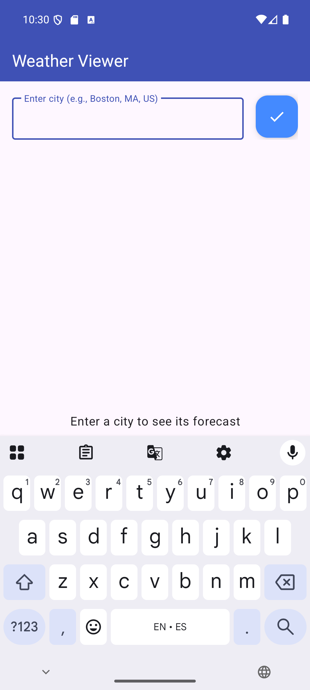
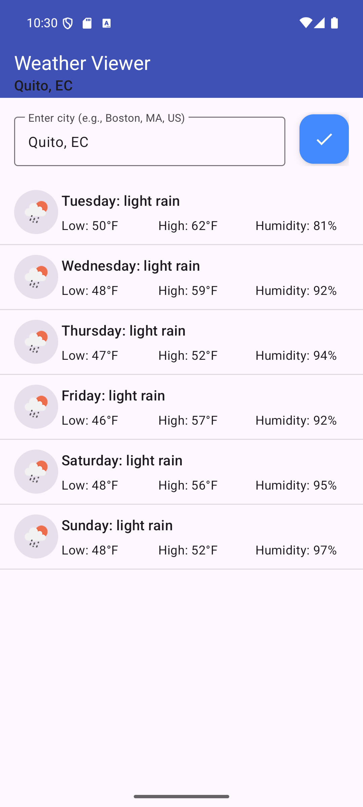
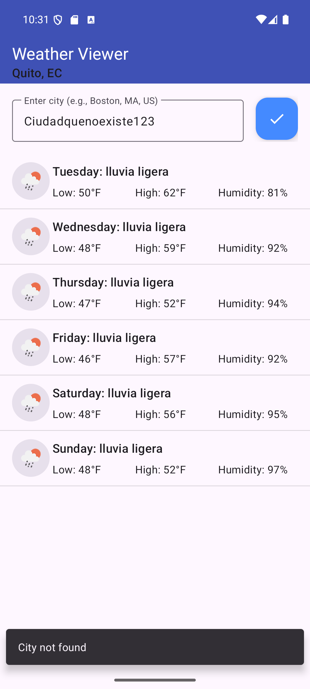
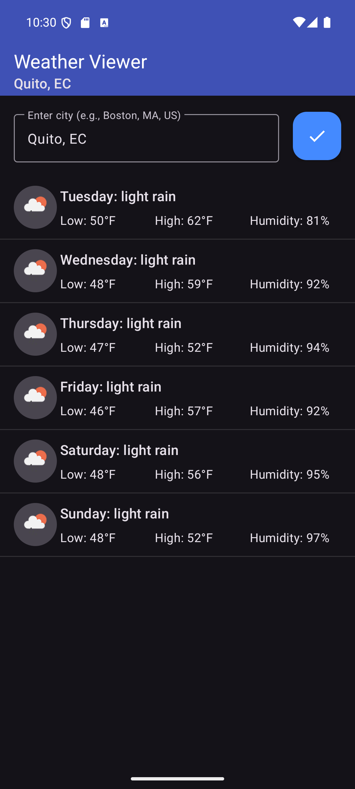
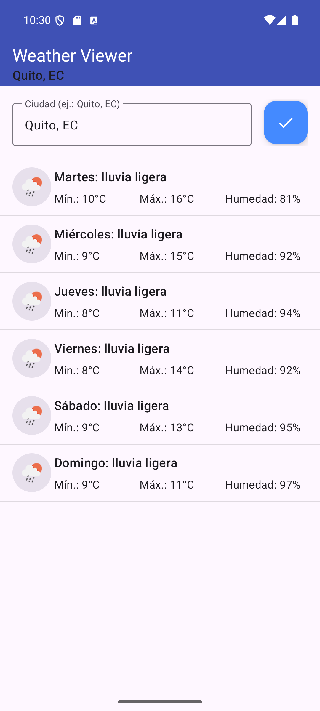
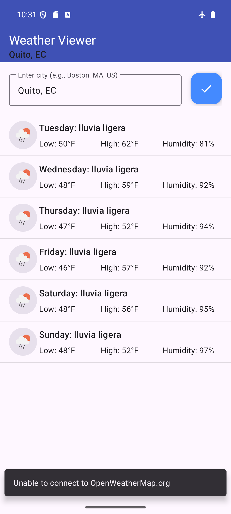
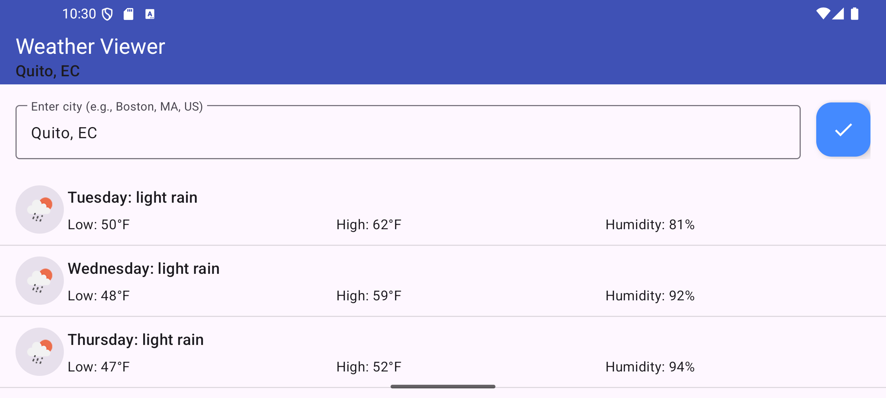
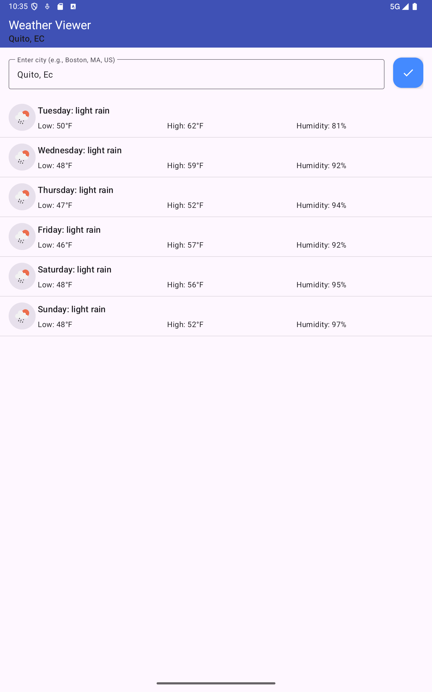
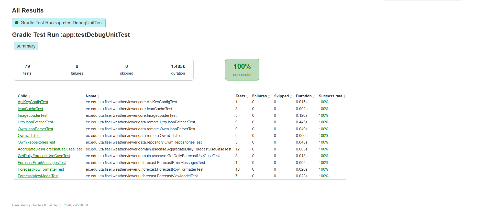
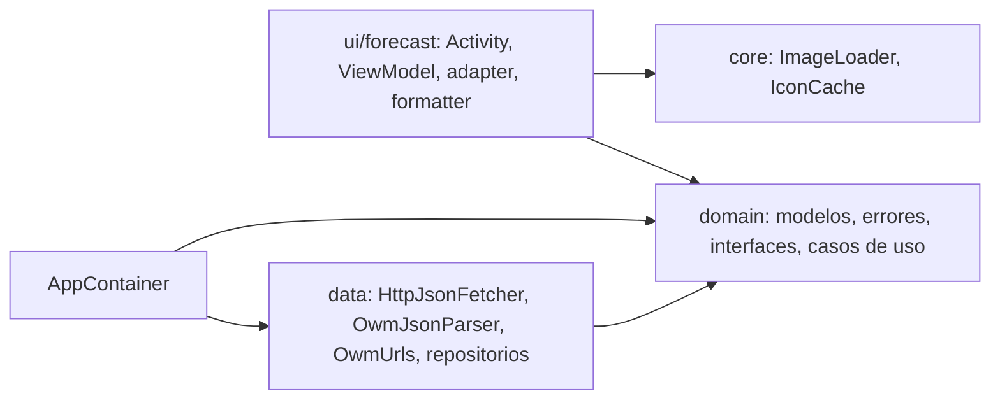

# Weather Viewer

Pronóstico del clima para Android: el usuario escribe una ciudad y la app muestra un día por fila, con ícono, descripción, mínima, máxima y humedad, usando los servicios REST de OpenWeatherMap.

Es la migración del **capítulo 7 de Deitel (2016)**, escrito en Java con `AsyncTask` para Android 6, a **Kotlin, corrutinas y Android 16 (API 36)**. El endpoint de 16 días del libro ya no existe en el plan gratuito, así que el pronóstico diario se calcula agregando lecturas cada 3 horas por día **local de la ciudad**.


> **Práctica 07** · Aplicaciones Móviles · Universidad Técnica de Ambato, FISEI
> Autor: Acosta Nuñez Edison Joel · Docente: Ing. Aladaz Flores Clay Fernando

---

## Capturas

<table>
  <tr>
    <td align="center"><br><sub>Estado vacío y teclado al abrir</sub></td>
    <td align="center"><br><sub>Pronóstico de Quito</sub></td>
    <td align="center"><br><sub>Ciudad no encontrada</sub></td>
  </tr>
  <tr>
    <td align="center"><br><sub>Modo oscuro: el pronóstico se conserva</sub></td>
    <td align="center"><br><sub>Español: días y descripciones</sub></td>
    <td align="center"><br><sub>Sin conexión</sub></td>
  </tr>
</table>

<table>
  <tr>
    <td align="center"><br><sub>Horizontal: sin bloqueo de orientación</sub></td>
    <td align="center"><br><sub>Pixel Tablet</sub></td>
  </tr>
</table>



---

## Funcionalidades

- **Búsqueda por ciudad**, con el botón flotante o la tecla de búsqueda del teclado.
- **Hasta 5 días** (hoy más los días completos): mínima y máxima del día, humedad promedio, e ícono y descripción de la lectura más cercana al **mediodía local de la ciudad**.
- **°C o °F** según la preferencia regional del sistema.
- **Descripciones del API en el idioma del teléfono** (`lang=es`) y días de la semana localizados.
- **Errores distinguibles:** consulta vacía, ciudad inexistente, key rechazada, sin conexión, servicio caído y respuesta ilegible.
- **Íconos que nunca aparecen en la fila equivocada**, aunque se desplace rápido la lista.
- **El pronóstico sobrevive** a la rotación y a los cambios de tema e idioma.
- **Inglés y español**, modo oscuro y edge-to-edge.

---

## Configuración de la API key

La key **no está en Git**. Agrégala a `local.properties`, en la raíz del proyecto:

```properties
OWM_API_KEY=tu_key_de_32_caracteres_hex
```

Sin key, la app compila igual y muestra "OpenWeatherMap rechazó la API key". La prueba `ApiKeyConfigTest` valida el formato sin imprimir la key y se ignora si no hay una.

---

## Qué cambió respecto al libro

|                        | PDF (2016)                                                                  | Este proyecto                                              |
| ---------------------- | --------------------------------------------------------------------------- | ---------------------------------------------------------- |
| Lenguaje, concurrencia | Java, `AsyncTask`                                                           | Kotlin, corrutinas (`viewModelScope`, `Dispatchers.IO`)    |
| Endpoint               | `forecast/daily?q=ciudad` (16 días)                                         | Geocoding + `forecast` 5 días/3 h + agregación propia      |
| Protocolo              | `http` (bloqueado desde API 28)                                             | `https`, `usesCleartextTraffic="false"`                    |
| API key                | En `strings.xml`, dentro del repositorio                                    | `local.properties` → `BuildConfig`                         |
| Día de la semana       | Zona horaria del **teléfono** (y aplicada dos veces)                        | Día local de la **ciudad** (`city.timezone`)               |
| Errores                | 2 mensajes genéricos; `null` → la app se cierra                             | 6 fallos tipados, cada uno con su mensaje                  |
| Íconos                 | Caché `HashMap` escrito desde varios hilos; ícono viejo en filas recicladas | LRU en el hilo principal; carga cancelada al reciclar      |
| Estado                 | Campos de la Activity; orientación bloqueada                                | ViewModel + `StateFlow`; rota libremente                   |
| Pruebas                | 0                                                                           | 79 unitarias (sin red) + 3 instrumentadas (sin red ni key) |

- **Catálogo de correcciones** (los `#n` coinciden con los comentarios del código): [docs/COMPATIBILIDAD.md](docs/COMPATIBILIDAD.md)
- **Contrato del API medido** con key real: [docs/api/CONTRATO.md](docs/api/CONTRATO.md)

---

## Arquitectura

Arquitectura limpia con un punto de composición único (`AppContainer`).



Flujos, manejo de errores y decisiones: [docs/ARQUITECTURA.md](docs/ARQUITECTURA.md)

---

## Tecnologías

| Herramienta                              | Versión                  |
| ---------------------------------------- | ------------------------ |
| Android Gradle Plugin                    | 9.4.1 (Kotlin integrado) |
| Gradle                                   | 9.6.0                    |
| compileSdk / targetSdk / minSdk          | 37 / 36 / 24             |
| AndroidX Core, AppCompat, Activity       | 1.19.0, 1.8.0, 1.13.0    |
| Material Components                      | 1.14.0                   |
| kotlinx-coroutines (core, android, test) | 1.10.2                   |
| org.json real (solo en pruebas)          | 20251224                 |
| MockWebServer (OkHttp)                   | 4.12.0                   |
| JUnit, AndroidX JUnit, Espresso          | 4.13.2, 1.3.0, 3.7.0     |

---

## Cómo ejecutarlo

```bash
git clone <url-del-repositorio>
cd P07_WeatherViewer
# agregar OWM_API_KEY a local.properties
gradlew installDebug
```

## Pruebas

```bash
gradlew test                        # 79 unitarias, sin red (1 se ignora si no hay key)
gradlew connectedDebugAndroidTest   # 3 instrumentadas, sin red ni key
gradlew lint                        # 0 errores
```

Estrategia, técnicas y límites: [docs/PRUEBAS.md](docs/PRUEBAS.md)

---

## Documentación

| Documento                                     | Contenido                                              |
| --------------------------------------------- | ------------------------------------------------------ |
| [COMPATIBILIDAD.md](docs/COMPATIBILIDAD.md)   | Catálogo de correcciones #1–#31                        |
| [ANALISIS_DISENO.md](docs/ANALISIS_DISENO.md) | SOLID, STUPID, errores del libro y deuda técnica       |
| [ARQUITECTURA.md](docs/ARQUITECTURA.md)       | Capas, flujos, errores, agregación, íconos, decisiones |
| [PRUEBAS.md](docs/PRUEBAS.md)                 | Estrategia, cobertura, técnicas y verificación manual  |
| [PLAN.md](docs/PLAN.md)                       | Fases y commits                                        |
| [api/CONTRATO.md](docs/api/CONTRATO.md)       | Respuestas reales de OpenWeatherMap (2026-09-23)       |

---

## Estructura

```
P07_WeatherViewer/
├── app/src/main/java/ec/edu/uta/fisei/weatherviewer/
│   ├── AppContainer.kt, WeatherViewerApp.kt   Composición
│   ├── core/                IconCache (LRU), ImageLoader (cancela al reciclar)
│   ├── domain/              model/, repository/ (interfaces), usecase/
│   ├── data/remote/         HttpJsonFetcher, OwmJsonParser, OwmUrls
│   ├── data/repository/     OwmGeocodingRepository, OwmForecastRepository
│   └── ui/forecast/         Activity, ViewModel, UiState, adapter, formatter, mensajes
├── app/src/test/            79 pruebas + fakes + fixtures reales
├── app/src/androidTest/     3 pruebas con contenedor falso
└── docs/                    api/ (contrato), evidencia/ (fase 6), img/ (capturas)
```

---

## Convenciones

- **Idioma:** la API pública (clases, métodos, propiedades) en inglés; variables locales, funciones privadas y nombres de prueba en español. Mismo criterio que P05.
- **Pruebas instrumentadas:** nombres con guion bajo, porque DEX no admite espacios con minSdk < 30.
- **Defectos numerados:** `bug #n` e `incompatibilidad #n` en el código remiten a [COMPATIBILIDAD.md](docs/COMPATIBILIDAD.md).

---

## Limitaciones conocidas

Detalladas en [ANALISIS_DISENO.md §7](docs/ANALISIS_DISENO.md). Las principales:

- Hasta 5 días, no 16: es el límite del plan gratuito.
- Al cambiar de idioma, las descripciones ya cargadas siguen en el idioma anterior hasta la próxima búsqueda.
- La key viaja dentro del APK (aceptable en un curso; en producción iría detrás de un backend).

---

## Créditos

- Basado en el capítulo 7 (WeatherViewer App) de P. Deitel, H. Deitel y A. Wald, _Android 6 for Programmers: An App-Driven Approach_, 3.ª ed., Pearson, 2016. Uso académico.
- Datos e íconos del clima: [OpenWeatherMap](https://openweathermap.org), bajo sus términos de uso.
