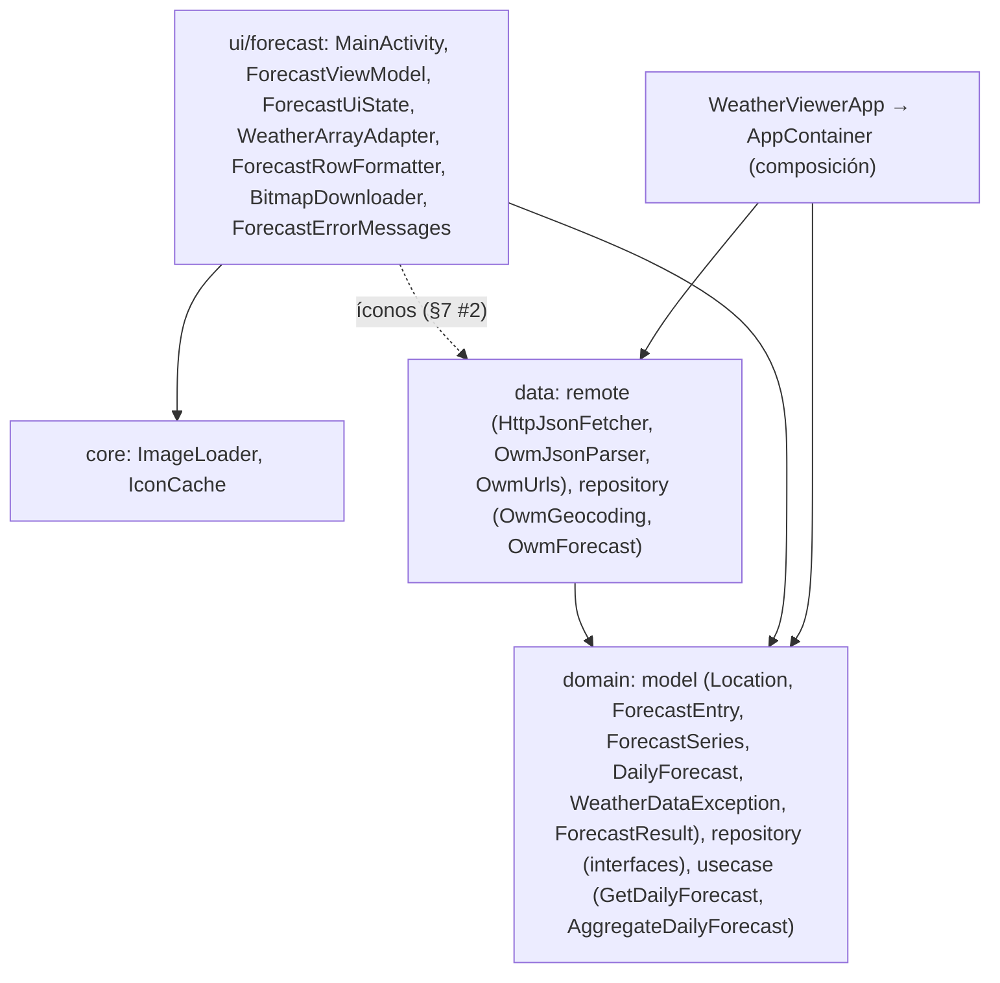
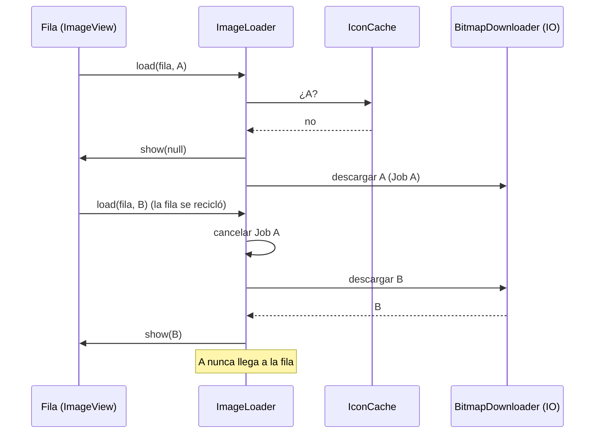

# Weather Viewer — Arquitectura

> Rutas relativas a `app/src/main/java/ec/edu/uta/fisei/weatherviewer/`.

---

## 1. Vista general

- **Patrón:** arquitectura limpia + MVVM (`StateFlow`).
- **Pantalla:** una Activity con una lista (`ListView` + `WeatherArrayAdapter`).
- **Composición:** `WeatherViewerApp.container` (diferido) → `AppContainer.production(key)`.
- **Hilos:** principal (UI, caché de íconos) y `Dispatchers.IO` (HTTP, decodificación).



---

## 2. De las clases del PDF a la estructura actual

| PDF                                                 | Ahora                                                                                                      |
| --------------------------------------------------- | ---------------------------------------------------------------------------------------------------------- |
| `MainActivity` + `GetWeatherTask`                   | `MainActivity` (render, búsqueda, insets) + `ForecastViewModel` + `GetDailyForecastUseCase` + repositorios |
| `createURL`                                         | `OwmUrls`                                                                                                  |
| `HttpURLConnection` (dos veces)                     | `HttpJsonFetcher.get` / `getBytes`                                                                         |
| `convertJSONtoArrayList`                            | `OwmJsonParser` + `AggregateDailyForecastUseCase`                                                          |
| `Weather` (textos formateados)                      | `DailyForecast` (números) + `ForecastRowFormatter`                                                         |
| `WeatherArrayAdapter` + `LoadImageTask` + `HashMap` | `WeatherArrayAdapter` + `ImageLoader` + `IconCache` + `BitmapDownloader`                                   |
| `connect_error`, `read_error`                       | `ForecastResult.Failure` (6) → `messageRes()`                                                              |

---

## 3. Flujo de una búsqueda

```mermaid
sequenceDiagram
    actor U as Usuario
    participant A as MainActivity
    participant VM as ForecastViewModel
    participant UC as GetDailyForecastUseCase
    participant G as OwmGeocodingRepository
    participant F as OwmForecastRepository
    participant AG as AggregateDailyForecastUseCase

    U->>A: FAB o tecla de búsqueda
    A->>A: ocultar teclado
    A->>VM: onSearch("Quito, EC")
    VM->>VM: cancelar la búsqueda anterior; isLoading = true
    VM->>UC: invoke (viewModelScope)
    UC->>G: findLocation (IO) → GET /geo/1.0/direct
    G-->>UC: Location o null (CityNotFound)
    UC->>F: getForecast(lat, lon) (IO) → GET /data/2.5/forecast
    F-->>UC: ForecastSeries (40 lecturas + timezone)
    UC->>AG: agregar por día local
    UC-->>VM: ForecastResult.Success / Failure
    VM-->>A: StateFlow → render()
```

---

## 4. Errores de extremo a extremo

| Origen                     | `HttpJsonFetcher` / parser | `GetDailyForecastUseCase`              | Mensaje (en)                |
| -------------------------- | -------------------------- | -------------------------------------- | --------------------------- |
| Consulta vacía             | —                          | `EmptyQuery` (no llama a la red)       | Enter a city first          |
| Geocoding `200 []`         | `null`                     | `CityNotFound` (no pide el pronóstico) | City not found              |
| HTTP 401                   | `Unauthorized`             | `Unauthorized`                         | …rejected the API key…      |
| `IOException` / timeout    | `NoConnection`             | `NoConnection`                         | Unable to connect…          |
| HTTP 429 o 5xx             | `ServiceUnavailable(code)` | `ServiceUnavailable`                   | …not available right now…   |
| Otro HTTP; `JSONException` | `UnexpectedResponse`       | `UnexpectedResponse`                   | Unable to read weather data |
| `CancellationException`    | —                          | **se propaga**                         | —                           |

Un fallo conserva `location` y `days` anteriores; el Snackbar se muestra una vez (`onErrorShown`) y solo con la pantalla en `STARTED`.

---

## 5. Agregación de 3 h a días

1. Ordenar las lecturas por hora.
2. Agrupar por `floorDiv(dt + city.timezone, 86 400)`: el día **local de la ciudad**.
3. Por día:
   - mínima de las mínimas;
   - máxima de las máximas;
   - humedad promedio redondeada;
   - ícono y descripción de la lectura más cercana al mediodía local (en un empate, la más temprana).
4. Conservar hoy siempre; los demás días solo si tienen ≥ 4 lecturas.

Londres (fixture real): 40 lecturas → 7/8/8/8/8/1 → **5 días** (el último, con una sola lectura, se descarta).

---

## 6. Íconos en filas recicladas



Un fallo no se guarda en la caché: se reintenta la próxima vez.

---

## 7. Estado y ciclo de vida

| Estado                           | Dónde                               | Rotación, tema, idioma | Muerte del proceso |
| -------------------------------- | ----------------------------------- | ---------------------- | ------------------ |
| Pronóstico, ciudad, carga, error | `ForecastViewModel.state`           | Se conserva            | Se pierde          |
| Texto del campo                  | `TextInputEditText` (estado propio) | Se conserva            | Se conserva        |
| Caché de íconos                  | `MainActivity`                      | Se pierde (§7 #6)      | Se pierde          |
| Contenedor                       | `WeatherViewerApp`                  | Se conserva            | Se recrea          |

- La recolección usa `repeatOnLifecycle(STARTED)`.
- El teclado solo se muestra al abrir por primera vez (`savedInstanceState == null`), no al rotar.

---

## 8. Decisiones de arquitectura

| #   | Decisión                            | Alternativa                     | Motivo                                                                    |
| --- | ----------------------------------- | ------------------------------- | ------------------------------------------------------------------------- |
| 1   | `HttpURLConnection`                 | Retrofit/OkHttp                 | Fidelidad al PDF; una clase pequeña y probada con MockWebServer           |
| 2   | org.json                            | Moshi/kotlinx.serialization     | Fidelidad; en pruebas, org.json **real** (el de `android.jar` es un stub) |
| 3   | Geocoding + 5 días/3 h + agregación | Endpoint diario pago            | Es lo disponible en el plan gratuito (CONTRATO)                           |
| 4   | Día local de la ciudad              | Zona del teléfono               | Corrige el #12                                                            |
| 5   | Errores sellados en el dominio      | Excepciones genéricas           | La UI no conoce HTTP; `when` exhaustivo                                   |
| 6   | `StateFlow` + `UiState` único       | LiveData / varios flujos        | Un valor describe toda la pantalla                                        |
| 7   | `ImageLoader` genérico propio       | Glide/Coil                      | Lo pide el capítulo; probable sin Android                                 |
| 8   | `AppContainer` manual               | Hilt                            | Un ViewModel; reemplazable en Espresso                                    |
| 9   | Key en `local.properties`           | En el código o en `strings.xml` | Fuera de Git; el build no falla sin ella                                  |
| 10  | `ListView`                          | `RecyclerView`                  | Fidelidad al capítulo (ANALISIS §7 #10)                                   |
